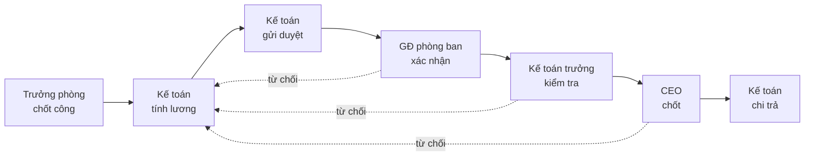

# BÁO CÁO: LUỒNG LƯƠNG DO PHÒNG TÀI CHÍNH - KẾ TOÁN ĐIỀU PHỐI

---

## 1. Bối cảnh và mục tiêu

Nhóm chia thêm 3 phòng ban: Kinh doanh, Tài chính - Kế toán, Công nghệ. Khi khảo sát code, phòng Tài chính - Kế toán **chưa có vai trò gì** trong hệ thống, trong khi:

- Module lương đã tính được đầy đủ (ngày công, đi trễ, OT, BHXH/BHYT/BHTN, thuế TNCN, giảm trừ người phụ thuộc).
- Tài liệu nghiệp vụ (`logic_nghiep_vu_CEO_va_GIAM_DOC_PB.txt`) ghi *"Khi CEO chốt, kế toán mới được xuất tiền"* nhưng code **không có bước kế toán**.

**Mục tiêu:** đưa phòng Tài chính - Kế toán thành trung tâm của quy trình lương: tính lương tập trung, kiểm soát chéo, chi trả và gửi phiếu lương.

---

## 2. Vấn đề của luồng cũ

| # | Vấn đề | Hậu quả |
|---|--------|---------|
| 1 | Mỗi Trưởng phòng tự tính lương cho phòng mình, rồi tự duyệt | Người quản lý vừa tính vừa duyệt lương cấp dưới, không có kiểm soát độc lập |
| 2 | Có 3 nơi bấm được "Tính lương" (Trưởng phòng, GĐ phòng, CEO) | Có thể ghi đè dữ liệu của nhau |
| 3 | Luồng dừng ở "CEO duyệt", không có bước chi tiền | Không biết lương đã trả hay chưa |
| 4 | **Lỗi:** trang phiếu lương của nhân viên lọc theo trạng thái `APPROVED`, mà luồng cũ không bao giờ đặt trạng thái này | Nhân viên **không bao giờ thấy phiếu lương** |
| 5 | Trưởng phòng và Giám đốc không có trang xem phiếu lương của chính mình | Thiếu chức năng |

---

## 3. Luồng mới

### 3.1. Tổng quan

Mỗi **phòng ban, mỗi tháng** là một **kỳ lương** riêng. Các phòng chạy độc lập: phòng nào chốt công xong thì kế toán tính được phòng đó, không phải chờ cả công ty.

### 3.2. Chi tiết từng bước

| Bước | Ai làm | Làm gì | Trạng thái sau |
|------|--------|--------|----------------|
| 1 | Trưởng phòng (hoặc GĐ phòng) của phòng đó | Chốt bảng công tháng. **Bị chặn** nếu còn đơn ngoại lệ chấm công chưa duyệt | `ATTENDANCE_CLOSED` |
| 2 | Kế toán (bất kỳ ai thuộc phòng TC-KT) | Bấm "Tính lương các phòng đã chốt công". Hệ thống tính cho mọi phòng đã chốt; phòng chưa chốt được liệt kê lý do | `DRAFT` |
| 3 | Kế toán | Gửi duyệt | `PENDING_DIRECTOR` (phòng không có GĐ thì chuyển thẳng `PENDING_CHIEF_ACCOUNTANT`) |
| 4 | Giám đốc của phòng đó | Xác nhận lương phòng mình | `PENDING_CHIEF_ACCOUNTANT` |
| 5 | Kế toán trưởng (TP hoặc GĐ phòng TC-KT) | Kiểm tra lần cuối, gửi CEO | `PENDING_CEO` |
| 6 | CEO | Chốt bảng lương | `APPROVED_BY_CEO` |
| 7 | Kế toán | Tải file CSV chi lương, chuyển khoản, nhập mã chứng từ, bấm "Xác nhận đã chi" | `PAID`: khóa bảng lương, gửi thông báo cho từng nhân viên |

**Các nhánh phụ:**

- **Từ chối:** ở bước 4, 5, 6 đều từ chối được, **bắt buộc ghi lý do**. Bảng lương về trạng thái `REJECTED`, ghi rõ ai từ chối, ở bước nào, lý do gì. Kế toán tính lại rồi gửi lại.
- **Mở lại công:** Trưởng phòng mở lại được khi bảng lương **chưa gửi duyệt** (`ATTENDANCE_CLOSED`, `DRAFT`, `REJECTED`). Bảng lương nháp bị hủy, chờ chốt công lại. Đã gửi duyệt thì phải nhờ người duyệt từ chối.
- **Cảnh báo:** khi tính lương, ai có **0 ngày công** hoặc **thực nhận bằng 0** sẽ được liệt kê trong mục "Cần kiểm tra trước khi gửi duyệt".

### 3.3. Thông báo tự động

| Sự kiện | Ai nhận thông báo |
|---------|-------------------|
| Trưởng phòng chốt / mở lại công | Toàn bộ phòng TC-KT |
| Kế toán gửi duyệt | Giám đốc phòng đó (hoặc kế toán trưởng nếu phòng không có GĐ) |
| GĐ xác nhận | Kế toán trưởng |
| Kế toán trưởng duyệt | CEO |
| CEO chốt | Phòng TC-KT (để chi trả) |
| Bất kỳ bước nào từ chối | Phòng TC-KT, kèm lý do |
| Đã chi trả | Từng nhân viên, kèm số tiền thực nhận |

### 3.4. Quy tắc kiểm soát

- **Tách bạch người tính và người quản lý:** Trưởng phòng không còn tính lương, chỉ chốt công.
- **Người gửi không tự duyệt:** kế toán trưởng đã tự gửi bảng lương thì không được tự kiểm duyệt bước 5; cần một kế toán trưởng khác.
- **Đúng phòng, đúng bước:** GĐ chỉ xác nhận phòng mình; mỗi thao tác chỉ làm được ở đúng trạng thái (sai trạng thái trả về lỗi 409).
- **Phạm vi xem:** CEO và phòng TC-KT xem toàn công ty; GĐ xem phòng mình; Trưởng phòng xem lương nhân viên và của chính mình (không xem lương GĐ); nhân viên thường không xem được bảng lương phòng.
- **Khóa sau khi chi:** bảng lương `PAID` không tính lại được.
- **Quyền do backend quyết định:** mỗi kỳ lương trả về danh sách `actions` người dùng hiện tại được làm. Giao diện chỉ hiện đúng các nút đó và không tự đoán quyền.

### 3.5. Nhận diện phòng Tài chính - Kế toán

Hệ thống chưa có mã phòng ban, nên **tạm nhận diện theo tên phòng** "Tài chính - Kế toán", giống cách code đang làm với phòng "Nhân sự".

- **Kế toán viên:** mọi thành viên đang hoạt động của phòng TC-KT.
- **Kế toán trưởng:** Trưởng phòng hoặc Giám đốc phòng TC-KT.

Toàn bộ logic này nằm trong một file (`FinanceAccess.java`). Khi nhóm làm phần mã phòng ban thì chỉ cần sửa file đó. Tên phòng có thể đổi qua cấu hình `payroll.finance-department-name`.

---

## 4. Chi tiết kỹ thuật

### 4.1. Cơ sở dữ liệu: migration `V23__payroll_finance_workflow.sql`

> Đánh số **V23** (không phải V19) vì nhánh `Tuong` đã dùng V19–V22 cho phòng Công nghệ. Nên merge nhánh `Tuong` vào `main` trước. Profile mặc định đang bật `out-of-order: true` nên nếu merge ngược thứ tự, Flyway vẫn chạy bù được các bản V19–V22.

- **Bảng `payroll_reports`:** mỗi dòng có `report_level = 'DEPARTMENT'` là một kỳ lương. Thêm cột:
  - Tổng thực nhận: `total_net_salary`.
  - Ai làm, lúc nào cho từng bước: `attendance_closed_*`, `generated_*`, `submitted_*`, `director_confirmed_*`, `chief_reviewed_*`, `ceo_approved_*`, `paid_*`.
  - Mã chứng từ chi trả: `payment_reference`.
  - Thông tin từ chối: `rejected_stage`, `rejected_by`, `rejection_reason`.
- **Bảng `payrolls`:** thêm `payroll_report_id` (phiếu thuộc kỳ lương nào) và `department_id` (phòng của nhân viên lúc tính lương).
- Dữ liệu luồng cũ (`MANAGER_LEVEL`, `DIRECTOR_LEVEL`) được giữ nguyên để tra cứu, không bị xóa.

### 4.2. API (`/api/payroll`)

| Method | Đường dẫn | Ai gọi |
|--------|-----------|--------|
| GET | `/access` | Mọi người: cho biết có phải kế toán / kế toán trưởng không |
| GET | `/batches?month&year` | Danh sách kỳ lương kèm `actions` được phép |
| GET | `/batches/{id}/items` | Chi tiết phiếu lương của kỳ |
| POST | `/attendance/close`, `/attendance/reopen` | Trưởng phòng / GĐ phòng |
| POST | `/finance/generate?month&year[&departmentId]` | Kế toán |
| POST | `/finance/batches/{id}/submit` | Kế toán |
| POST | `/director/batches/{id}/confirm` · `/reject` | GĐ phòng ban |
| POST | `/chief/batches/{id}/approve` · `/reject` | Kế toán trưởng |
| POST | `/ceo/batches/{id}/approve` · `/reject` | CEO |
| GET | `/finance/batches/{id}/bank-file` | Kế toán, CEO: file CSV chi lương (UTF-8 có BOM để Excel đọc được tiếng Việt) |
| POST | `/finance/batches/{id}/pay` | Kế toán, body `{ paymentReference }` |
| GET | `/me` | Phiếu lương cá nhân (chỉ hiện phiếu đã chi trả) |

Các API cũ của luồng trước (`/generate`, `/manager/*`, `/director/reports`, `/ceo/reports`…) đã được thay thế.

### 4.3. Công thức tính lương

**Giữ nguyên** công thức cũ (ngày công chuẩn, quy tắc đi trễ, nghỉ phép, gross, bảo hiểm trên lương cơ bản, ngưỡng 14 ngày, thuế TNCN lũy tiến, giảm trừ gia cảnh). Code chỉ được tách ra thành hàm `computePayroll` riêng.

### 4.4. Giao diện

| Thành phần | Mô tả |
|-----------|-------|
| Trang **Kế toán lương** (`PayrollPage.jsx`) | Dùng chung cho CEO, GĐ, TP, kế toán. Có: chọn tháng/năm, thanh quy trình 6 bước, ô tổng hợp (số phòng đã chốt công, số việc cần bạn xử lý, số phòng đã chi trả, tổng thực nhận), bảng kỳ lương, hộp xem chi tiết kèm lịch sử xử lý, hộp từ chối (bắt buộc lý do), hộp xác nhận chi trả (nhập mã chứng từ). Tab "Cấu hình lương nhân viên" của Trưởng phòng giữ nguyên |
| `PayrollBatchTable.jsx` (mới) | Màn hình rộng hiển thị dạng bảng; dưới 1024px hiển thị dạng thẻ để nút thao tác luôn nhìn thấy |
| Menu | Nhân viên phòng TC-KT có mục **"Kế toán lương"** (`/employee/finance-payroll`); Trưởng phòng TC-KT thấy mục "Lương" đổi tên thành "Kế toán lương"; TP và GĐ có thêm **"Phiếu lương của tôi"** (`/manager/my-payroll`, `/director/my-payroll`) |

---

## 5. Hướng dẫn chạy demo

### 5.1. Khởi động

1. MySQL local (cổng 3306, database `hrm_db`). Flyway tự chạy migration V23 khi backend khởi động, không cần chạy SQL bằng tay.
2. Backend: `cd Backend` → `mvnw spring-boot:run` (cổng 8080).
3. Frontend: `cd Frontend` → `npm run dev` (cổng 5173).

### 5.2. Tài khoản demo (dữ liệu seed, đăng nhập bằng mã nhân viên, mật khẩu demo mặc định trong `DataSeeder`)

| Vai trò trong luồng | Người | Mã NV |
|---------------------|-------|-------|
| Trưởng phòng Kinh doanh: chốt công | Phạm Quốc Huy | 03000001 |
| Kế toán viên: tính lương, gửi duyệt, chi trả | Lê Ngọc Mai | 05000002 |
| Giám đốc Kinh doanh: xác nhận | Nguyễn Minh Quân | 88000003 |
| Kế toán trưởng: kiểm tra lần cuối | Đỗ Thanh Bình | 05000001 |
| Tổng Giám đốc: chốt | CEO | 99000002 |
| Nhân viên Kinh doanh: xem phiếu lương | Nguyễn Hải Yến | 03000002 |

### 5.3. Kịch bản demo

1. **03000001** → Lương → chọn tháng → **Chốt công**.
2. **05000002** → Kế toán lương → **Tính lương các phòng đã chốt công** → xem cảnh báo (nếu có) → **Xem chi tiết** → **Gửi duyệt**.
3. **88000003** → Quản lý bảng lương → **Xác nhận** (hoặc **Từ chối** để demo nhánh trả về).
4. **05000001** → Kế toán lương → **Duyệt & gửi CEO**.
5. **99000002** → Quản lý bảng lương → **Chốt lương**.
6. **05000002** → **File ngân hàng** (tải CSV) → **Xác nhận đã chi** → nhập mã chứng từ.
7. **03000002** → Phiếu lương → thấy phiếu đã chi trả và thông báo trên chuông.

> Gợi ý: muốn số liệu lương khác 0 thì tháng demo cần có dữ liệu chấm công. DB local hiện chỉ có chấm công tháng 8–10/2026 và rất ít bản ghi cho phòng Kinh doanh, nên lương ra 0 đ (hệ thống sẽ cảnh báo).

---

## 6. Kết quả kiểm thử

### 6.1. Unit test (`PayrollWorkflowTest`, 6 test, đều pass)

1. Đi trọn chuỗi duyệt đến `PAID`, phiếu lương chuyển `PAID`, nhân viên nhận thông báo.
2. Kế toán trưởng tự gửi thì không được tự duyệt (403).
3. Phòng không có GĐ thì chuyển thẳng tới kế toán trưởng.
4. Trưởng phòng ngoài phòng TC-KT không tính được lương (403).
5. Chốt công bị chặn khi còn đơn ngoại lệ chưa duyệt.
6. CEO từ chối thì bảng lương về `REJECTED`, lưu bước và lý do.

Toàn bộ test backend: **60/60 pass**. Frontend build thành công.

### 6.2. Chạy thật qua API (tháng 11/2026)

Đủ 7 bước, gồm một vòng GĐ từ chối → kế toán tính lại → gửi lại. Các thao tác sai đều bị chặn:

- Trưởng phòng Kinh doanh gọi tính lương → **403**.
- Nhân viên thường xem bảng lương phòng → **403**.
- Kế toán trưởng duyệt khi còn chờ GĐ → **409**.

### 6.3. Chạy thật qua giao diện (tháng 10/2026)

Chốt công, tính lương, xem chi tiết, gửi duyệt, CEO chốt, xác nhận chi trả và xem "Phiếu lương của tôi" đều hoạt động đúng. Hai bước GĐ xác nhận và kế toán trưởng duyệt được chạy qua API vì dùng chung thành phần giao diện.

### 6.4. Lỗi phát hiện khi chạy thử và đã sửa

| Lỗi | Cách sửa |
|-----|----------|
| Bảng lương toàn số 0 vẫn gửi duyệt mà không có cảnh báo | Thêm cảnh báo "0 ngày công" / "thực nhận bằng 0" sau khi tính |
| Màn hình hẹp: cột "Thao tác" bị đẩy ra ngoài khung | Hiển thị dạng thẻ dưới 1024px |
| **Lỗi có sẵn của cả app:** hộp thoại bị lệch khỏi màn hình khi trang đã cuộn (hiệu ứng `animate-fade-in-up` trên `<main>` giữ lại `transform`, làm modal `position: fixed` bị neo theo `<main>`) | Sửa một dòng trong `index.css` (`forwards` → `backwards`). Hiệu ứng nhìn như cũ, mọi modal trong app hiển thị đúng |

---

## 7. Hạn chế và việc tiếp theo

- **Nhận diện phòng theo tên:** tạm thời; sẽ thay bằng mã phòng ban khi nhóm làm phần này.
- **Chưa lưu số tài khoản ngân hàng:** file CSV để trống cột số tài khoản và ngân hàng, kế toán điền tay trước khi tải lên ngân hàng.
- **Lương CEO** chưa nằm trong luồng (kỳ lương tính theo phòng ban, CEO không thuộc phòng nào).
- **Dữ liệu seed** vẫn tạo báo cáo lương kiểu cũ, nên tháng hiện tại hiển thị mọi phòng "Chưa chốt công". Phiếu lương seed kiểu cũ sẽ bị ghi đè khi kế toán bấm tính lương.
- **Đụng vào phần của thành viên khác:** API và giao diện duyệt lương cũ của Trưởng phòng, GĐ, CEO đã được thay; đã xóa `PayrollReportTable.jsx` (không còn dùng); sửa chỗ đếm "lương đã duyệt" trong Telegram bot cho khớp trạng thái mới. Cần báo nhóm.
- **Ý tưởng tiếp theo cho phòng TC-KT:** tạm ứng / thanh toán chi phí có AI đọc hóa đơn; ngân sách nhân sự theo phòng ban; báo cáo thuế TNCN và bảo hiểm phần doanh nghiệp đóng; dashboard tài chính kèm AI phát hiện bất thường.

---

## 8. Danh sách file thay đổi

**Backend**

| File | Thay đổi |
|------|----------|
| `common/payroll/service/PayrollService.java` | Viết lại theo luồng mới (giữ công thức tính) |
| `common/payroll/service/FinanceAccess.java` | **Mới:** nhận diện kế toán / kế toán trưởng |
| `common/payroll/controller/PayrollController.java` | Viết lại API |
| `common/payroll/dto/PayrollBatchView.java` | **Mới:** dữ liệu kỳ lương trả về giao diện |
| `common/payroll/entity/Payroll.java`, `PayrollReport.java` | Thêm cột mới |
| `common/payroll/repository/PayrollRepository.java` | Thêm `findByPayrollReportId` |
| `telegram/TelegramAiConversationService.java`, `TelegramHrmDataService.java` | Đếm lương đã duyệt theo trạng thái mới |
| `resources/db/migration/V23__payroll_finance_workflow.sql` | **Mới:** migration |
| `test/.../PayrollWorkflowTest.java` | **Mới:** 6 unit test |

**Frontend**

| File | Thay đổi |
|------|----------|
| `pages/manager/payroll/PayrollPage.jsx` | Làm lại trang lương |
| `components/payroll/PayrollBatchTable.jsx` | **Mới:** bảng / thẻ kỳ lương |
| `components/payroll/PayrollTable.jsx` | Chỉ còn chức năng xem, badge trạng thái mới |
| `components/payroll/PayrollReportTable.jsx` | **Xóa** (không còn dùng) |
| `utils/payrollStatus.js` | **Mới:** nhãn trạng thái |
| `App.jsx` | Route `finance-payroll`, `my-payroll` |
| `components/layout/AppLayout.jsx` | Menu "Kế toán lương", "Phiếu lương của tôi" |
| `pages/manager/payroll/PayrollViewPage.jsx` | Đổi tiêu đề "đã chi trả" |
| `index.css` | Sửa lỗi modal bị lệch khi cuộn |

**Khác:** `.claude/launch.json` (cấu hình khởi động backend và frontend trong app Claude).
